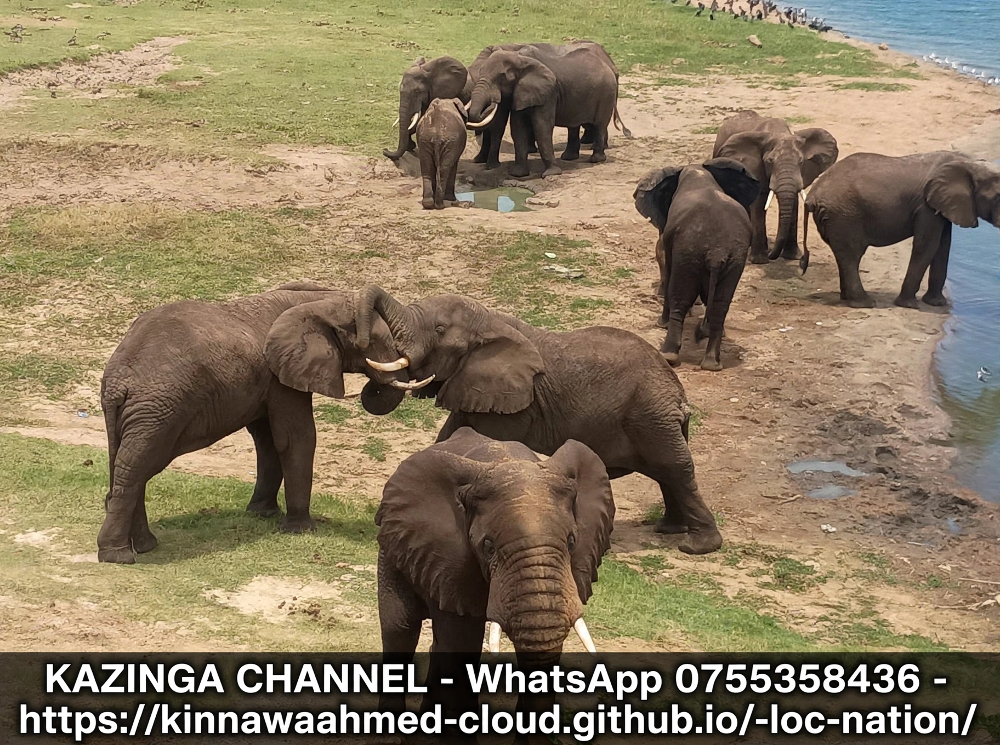
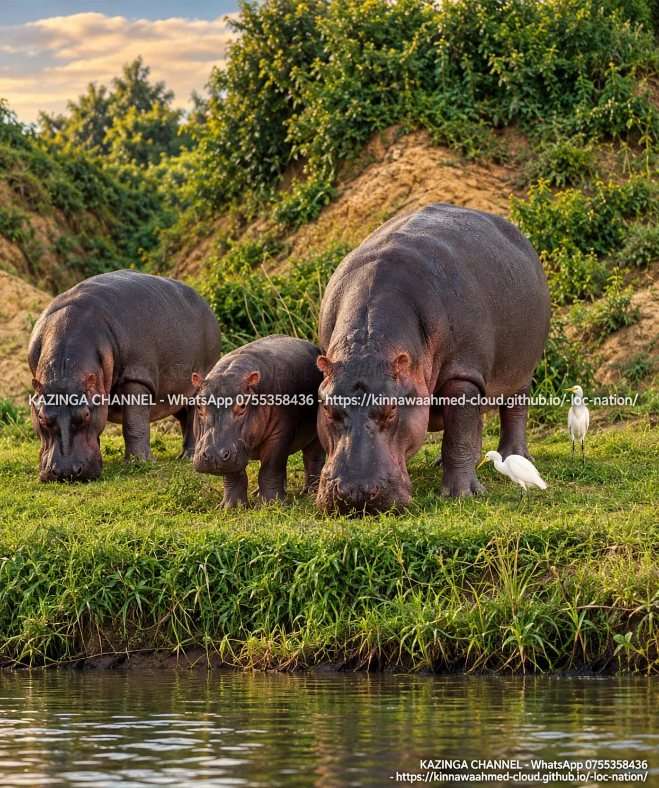

# -kazinga-channel-community-heritage-media
 : A community heritage media project documenting and promoting the cultural heritage, stories, people, traditions, and natural heritage of communities around Kazinga Channel.
## 🐘 OUR WILDLIFE GALLERY - Kazinga Channel

### Elephants & Buffaloes - Real Photos From Our Village

### 🎥 Videos - Boat Safari & Wildlife

<video controls width="100%">
  <source src="20260625_184535.mp4" type="video/mp4">
</video>

<video controls width="100%">
  <source src="20260625_191639.mp4" type="video/mp4">
</video>

---
**Boating: 40,000 UGX | WhatsApp: 0755358436**
**Website: https://kinnawaahmed-cloud.github.io/-loc-nation/**
